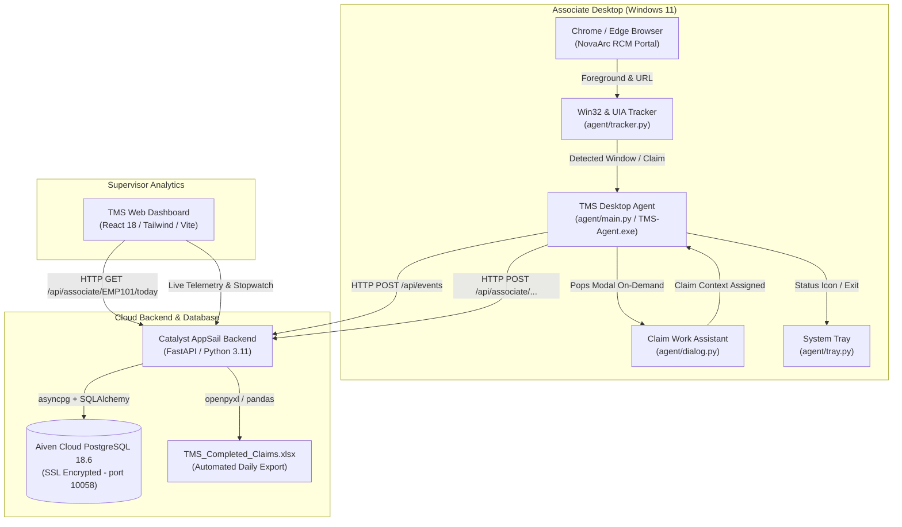

# Architecture Overview

## Architectural Tenets
1. **Zero Disturbance / Zero Lag**: Desktop telemetry operates in an async loop with sub-millisecond local caching, ensuring no stutter for the associate.
2. **Deterministic State Reconciliation**: All claim updates made on NovaArc platform are polled and pushed to Aiven PostgreSQL within 1-2 seconds.
3. **Resilient Data Persistence**: Aiven Cloud PostgreSQL 18.6 serves as the single source of truth for telemetry and audit compliance, backed up continuously.
