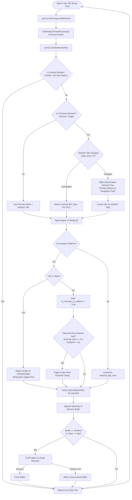
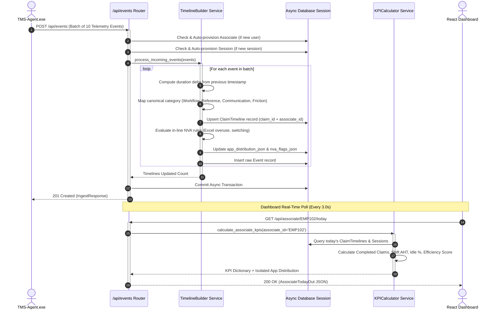
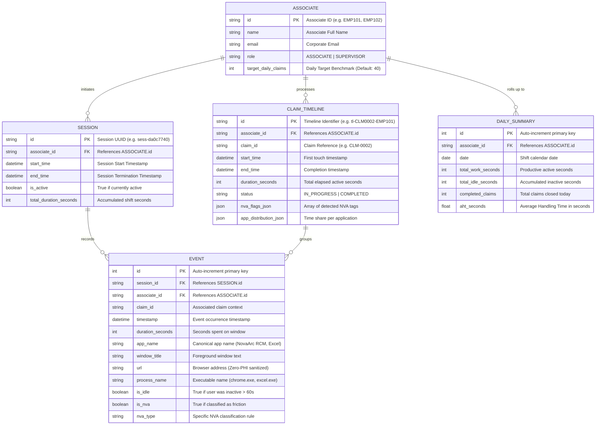
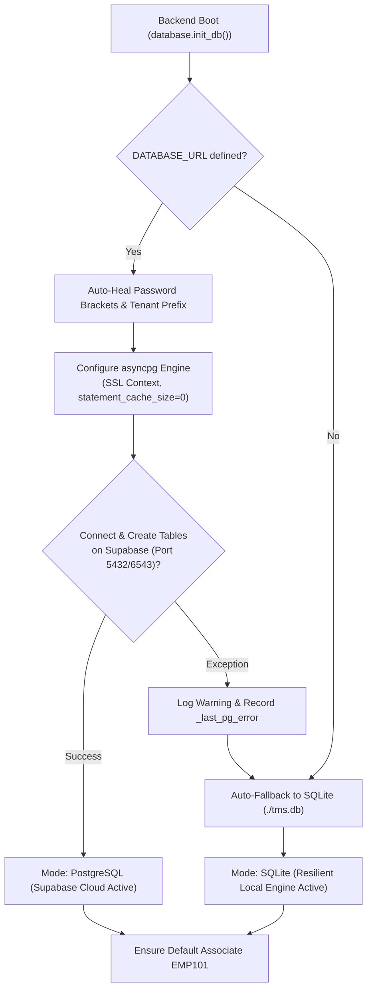
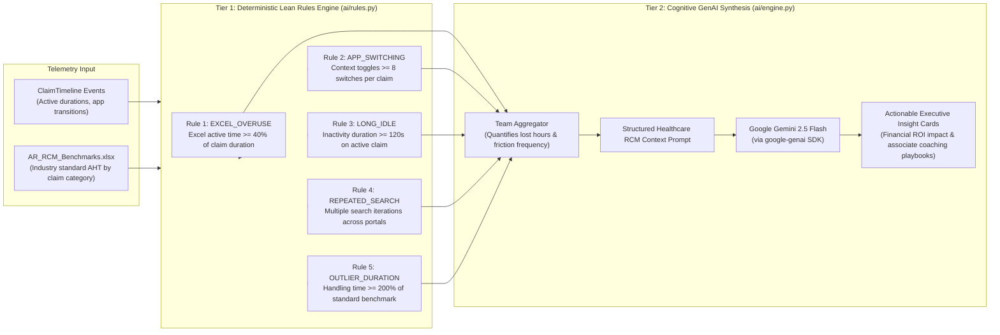
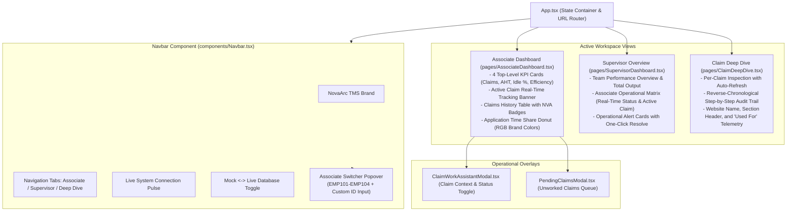

# NovaArc TMS - Comprehensive Architecture & System Design Dossier

> **Transaction Management System (TMS) & Effort Intelligence Platform for Revenue Cycle Management (AR Operations)**  
> *End-to-End Enterprise Architecture, Subsystem Designs, Data Models, Binary Packaging, and Execution Workflows*

 *

## Table of Contents

1. End-to-End System-Wide Architecture
2. Component 1: Desktop Telemetry Agent (TMS-Agent.exe)Agent Pipeline DiagramDetailed Operating MechanicsAnatomy of TMS-Agent.exeKey Functions & Implementation Manifest
3. Component 2: Backend Core API & Processing Engine (backend/)Backend Processing Flow DiagramDetailed Operating MechanicsKey Functions & Implementation Manifest
4. Component 3: Database & Relational Persistence Architecture (backend/models.py)Entity-Relationship (ER) DiagramTable Definitions & Schema ContractsSupabase Managed PostgreSQL & Resilient Local Failover
5. Component 4: AI Reasoning & Friction Heuristics Engine (ai/)Dual-Tier Analytics ArchitectureThe 5 Deterministic Lean NVA RulesCognitive GenAI Synthesis via Google GeminiKey Functions & Implementation Manifest
6. Component 5: SaaS Web Dashboard Frontend (dashboard/)Frontend Architecture & Component TreeMulti-User Identity & State SynchronizationKey Functions & Implementation Manifest
7. Full Technology Stack Matrix

 *

## 1\. End-to-End System-Wide Architecture

The TMS platform consists of five interconnected subsystems:

1. Windows Desktop Telemetry Daemon (TMS-Agent.exe): Passively captures active window metadata, browser URLs, and idle durations with 0% CPU footprint.
2. FastAPI Core Backend Microservice (tms-backend): Ingests high-frequency telemetry, reconstructs claim timelines, calculates KPIs, and isolates multi-user claim states.
3. Relational Persistence Layer (Supabase PostgreSQL / Resilient SQLite): Dual-mode async database with automatic zero-downtime failover.
4. FastAPI AI Intelligence Microservice (tms-ai): Executes 5 sub-millisecond Lean NVA heuristics and invokes Google Gemini for financial ROI analysis.
5. React 18 + Vite SaaS Dashboard: Real-time operational command center with live auto-polling and multi-associate switching.

```mermaid
flowchart TB
    subgraph ClientLayer ["1. WORKSTATION LAYER - Windows OS Client"]
        direction TB
        subgraph WorkerApps ["Active Healthcare Workstation Apps"]
            Chrome["Google Chrome / Edge<br>NovaArc RCM Platform"]
            Excel["Microsoft Excel<br>Fee Schedules and Worklists"]
            Payer["Payer Portals<br>Availity, UHC, Medicare"]
        end

        subgraph Daemon ["TMS-Agent.exe - Zero-Dependency Windows Daemon"]
            W32["Win32 Sensor Hooks<br>GetForegroundWindow, GetLastInputInfo"]
            UIA["UIAutomation COM Engine<br>Omnibox URL and Zero-PHI Sanitizer"]
            Regex["Regex Parser<br>Matches CLM Pattern"]
            CCM["ClaimContextManager<br>Active Claim State Machine"]
            Tkinter["Tkinter Dialog<br>Claim Work Assistant Prompt"]
            Emitter["EventEmitter and Buffer<br>10 items / 30s flush"]
            DiskQueue["Offline Queue Buffer<br>agent/queue.jsonl"]
        end

        Chrome & Excel & Payer -.->|Active Window Handle| W32
        W32 --> UIA --> Regex --> CCM
        CCM <--> Tkinter
        CCM --> Emitter
        Emitter -.->|Network Outage| DiskQueue
        DiskQueue -.->|On Reconnect Replay| Emitter
    end

    subgraph BackendLayer ["2. CLOUD CORE BACKEND - FastAPI on Render"]
        direction TB
        IngestRoute["Bulk Ingestion Endpoint<br>POST /api/events"]
        SessRoute["Session Controller<br>POST /api/sessions/start, /end"]
        AssocRoute["Associate Controller<br>GET /today, POST /active-claim"]
        TeamRoute["Team Supervisor Controller<br>GET /overview, POST /alerts/resolve"]
        
        TLBuilder["TimelineBuilder Service<br>Duration math, category mapping"]
        KPICalc["KPI Calculator Engine<br>AHT, Idle %, Efficiency Score"]
        ExcelExp["Time & Motion Exporter<br>openpyxl - TMS_Completed_Claims.xlsx"]

        IngestRoute --> TLBuilder
        TLBuilder --> KPICalc
        AssocRoute --> KPICalc
        TeamRoute --> KPICalc
        AssocRoute --> ExcelExp
    end

    subgraph StorageLayer ["3. RELATIONAL PERSISTENCE - Supabase / Resilient Engine"]
        direction TB
        Pooler["asyncpg Connection Pooler<br>Prepared Statement Cache: 0"]
        SupabaseDB["Supabase PostgreSQL<br>AWS ap-southeast-1 Managed Cloud"]
        LocalFallback["Resilient SQLite Engine<br>tms.db Auto-Failover"]
        
        Pooler --> SupabaseDB
        Pooler -.->|On DB Unreachable| LocalFallback
    end

    subgraph AILayer ["4. AI & HEURISTICS MICROSERVICE - FastAPI on Render"]
        direction TB
        NVAEngine["5-Rule Deterministic Engine<br>Excel Overuse, App Switching, Long Idle"]
        Aggregator["Team Metrics Aggregator<br>Shift Friction & Lost Hours"]
        GeminiEngine["Google Gemini 2.5 Flash<br>Generative Executive Coaching"]

        NVAEngine --> Aggregator --> GeminiEngine
    end

    subgraph DashboardLayer ["5. SAAS DASHBOARD - React 18 & Vite on GitHub Pages"]
        direction TB
        URLRouter["Dynamic User Router<br>user query param / localStorage"]
        AssocSwitcher["Interactive Associate Switcher<br>EMP101-EMP104 and Custom ID"]
        AssocView["Associate Workspace<br>Active Claim, RGB Donut, Audit Trail"]
        SuperView["Supervisor Matrix<br>Team AHT, Alert Resolve, Drill-Down"]
        DeepDiveView["Claim Deep Dive<br>Reverse-Chronological Audit Steps"]

        URLRouter --> AssocSwitcher
        AssocSwitcher --> AssocView & SuperView & DeepDiveView
    end

    %% Inter-Subsystem Communication
    Emitter ==>|HTTPS REST - POST JSON Batches| IngestRoute
    TLBuilder <==>|Async SQLAlchemy 2.0| Pooler
    SessRoute <==>|Async SQLAlchemy 2.0| Pooler
    KPICalc <==>|Async SQLAlchemy 2.0| Pooler
    TeamRoute <==>|Internal HTTPS| NVAEngine
    
    AssocView ==>|HTTP GET /api/associate/id/today| AssocRoute
    SuperView ==>|HTTP GET /api/team/overview| TeamRoute
    DeepDiveView ==>|HTTP GET /api/associate/{id}/claims/{cid} (5s Poll)| AssocRoute
```

 *

## 2\. Component 1: Desktop Telemetry Agent (`TMS-Agent.exe`)

The Windows Desktop Agent acts as the sensory nervous system on each employee workstation. It operates completely in the background without requiring user input or administrative clock-in.

### Agent Pipeline Diagram



### Detailed Operating Mechanics

#### 1\. Zero-CPU Browser URL Inspection & Title Caching

*   Traditional UIAutomation walkers recursively inspect thousands of DOM elements on the main thread, causing 15-30% CPU spikes and system freezes.
*   TMS implements **`WindowTracker.get_browser_url()`** with a **3.0-second TTL cache** indexed by `(hwnd, window_title)`.
*   If an associate is actively typing in a claim page and the window title has not changed, the URL returns in **0.0ms with 0% CPU consumption**.

#### 2\. Claim ID Regex Extraction

*   Extracted window titles and URLs are scanned with `CLM\d{4,8}` (e.g., `CLM-0002`, `CLM-1004`, `CLM8821`).
*   The matched ID is registered into the thread-safe `ClaimContextManager`.

#### 3\. Cross-Application Context Locking

*   When an associate switches away from NovaArc RCM to Microsoft Excel (to check fee schedules) or a clearinghouse portal (to check coverage), the agent retains the current active claim ID.
*   Every second spent in external applications is attributed to that exact claim journey.

#### 4\. Automatic NovaArc Authentication & Logout Detection

*   **Sign-in**: When the URL changes from `/login` to `/` or any internal dashboard route, the agent immediately activates tracking and prompts the Claim Work Assistant.
*   **Sign-out**: When the URL navigates back to `https://novarc.vercel.app/login`, the agent resets `has_logged_in_to_office = False`, clears active claim context, attributes subsequent activity to `UNASSIGNED`, and notifies the cloud backend.

#### 5\. Dialog Debounce Loop Prevention

*   Closing or submitting the Claim Work Assistant dialog explicitly sets `is_currently_on_platform = True`, `external_app_ticks = 0`, and timestamps `last_dialog_close_time`.
*   Internal Tkinter windows and Windows focus transitions are filtered out.
*   The assistant will **never trigger in a loop** unless the user has genuinely navigated to an external application for $\ge 2$ consecutive ticks ($\ge 1.0$s) and the 4.0-second cooldown has expired.

#### 6\. Dynamic Multi-User Identity Resolution

To support multi-user testing without cross-user data collision:

1. CLI Flag: TMS-Agent.exe --associate EMP102
2. Environment Variable: TMS_ASSOCIATE_ID=EMP102
3. Local Text File: associate_id.txt in the same directory
4. Interactive Launcher: [Start-Agent.bat](file:///b:/Projects/TMS/Start-Agent.bat) prompts the user on startup
5. Machine Fallback: EMP-<WindowsUsername> (e.g. EMP-GOKUL)

 *

### Anatomy of `TMS-Agent.exe`

`TMS-Agent.exe` is a 40.5 MB self-contained binary packaged via PyInstaller:

```sql
┌────────────────────────────────────────────────────────────────────────┐
│                        TMS-Agent.exe Structure                         │
├────────────────────────────────────────────────────────────────────────┤
│ 1. Windows C-Runtime Bootloader (runw.exe)                             │
│    - Headless entrypoint (no command prompt window spawned)            │
│    - Allocates memory and unpacks Python runtime to _MEIxxxxxx temp    │
├────────────────────────────────────────────────────────────────────────┤
│ 2. Python 3.11 / 3.14 Core Runtime                                     │
│    - python3.dll, python314.dll, base_library.zip                      │
│    - Complete standard library (asyncio, json, ssl, time, threading)   │
├────────────────────────────────────────────────────────────────────────┤
│ 3. Native Windows C-Extensions & Drivers                               │
│    - pywin32 (win32gui, win32process, win32con, win32api)              │
│    - comtypes (UIAutomation COM interfaces for Chrome / Edge)          │
│    - psutil (process hierarchy and resource footprint monitoring)      │
│    - _tkinter, tcl86t.dll, tk86t.dll (native OS dialog system)         │
│    - requests, urllib3, cryptography, certifi (SSL/TLS HTTPS stack)    │
│    - pystray, PIL (system tray icon and notification manager)          │
├────────────────────────────────────────────────────────────────────────┤
│ 4. Bundled Data Contracts & Configurations                             │
│    - config.json (Default poll interval: 0.5s, Render cloud URLs)      │
│    - shared/app-map.json (Process-to-Application canonical dictionary) │
├────────────────────────────────────────────────────────────────────────┤
│ 5. Compiled Application Bytecode                                       │
│    - main.pyc (Master daemon loop and identity resolver)               │
│    - tracker.pyc (Window tracking, UIAutomation, caching, and filter)  │
│    - idle_monitor.pyc (User inactivity and mouse tick detection)       │
│    - claim_context.pyc (Active claim state machine)                    │
│    - emitter.pyc (Batch buffer and offline disk queue drainer)         │
│    - dialog.pyc (Tkinter manual claim entry UI)                        │
│    - tray.pyc (System tray background management)                      │
└────────────────────────────────────────────────────────────────────────┘
```

### Agent Key Functions & Implementation Manifest

| Component | Function / Class | Source File | Description |
| :--- | :--- | :--- | :--- |
| **Identity** | \[`resolve_associate_identity()`\](file:///b:/Projects/TMS/agent/main.py#L23-L75) | `agent/main.py` | Priority-based associate identity resolver (CLI > Env > Text > Config > Machine). |
| **Tracking** | \[`WindowTracker.get_active_window()`\](file:///b:/Projects/TMS/agent/tracker.py#L74-L125) | `agent/tracker.py` | Retrieves active window handle, process name, and canonical application name. |
| **URL Extraction** | \[`WindowTracker.get_browser_url()`\](file:///b:/Projects/TMS/agent/tracker.py#L127-L248) | `agent/tracker.py` | Extracts URL using UIAutomation with 3.0s `(hwnd, title)` cache TTL for 0% CPU. |
| **Filter** | \[`is_internal_agent_window()`\](file:///b:/Projects/TMS/agent/tracker.py#L250-L270) | `agent/tracker.py` | Detects and filters out Tkinter dialogs, task switchers, and OS flickers. |
| **Idle Monitor** | \[`IdleMonitor.get_idle_seconds()`\](file:///b:/Projects/TMS/agent/idle\_monitor.py#L25-L45) | `agent/idle_monitor.py` | Measures user keyboard/mouse inactivity using `GetLastInputInfo`. |
| **Context State** | \[`ClaimContextManager.set_manual_claim()`\](file:///b:/Projects/TMS/agent/claim\_context.py#L30-L60) | `agent/claim_context.py` | Thread-safe active claim context state manager. |
| **Telemetry** | \[`EventEmitter.emit()` & `flush()`\](file:///b:/Projects/TMS/agent/emitter.py#L38-L100) | `agent/emitter.py` | Buffers events and executes resilient HTTP batch posts to Render. |
| **Master Daemon** | \[`AgentDaemon.run()`\](file:///b:/Projects/TMS/agent/main.py#L425-L670) | `agent/main.py` | Main 0.5s polling loop coordinating sensors, dialogs, logout, and flusher. |

 *

## 3\. Component 2: Backend Core API & Processing Engine (`backend/`)

The Core Backend receives real-time telemetry from desktop agents and serves analytical endpoints to the executive dashboard.

### Backend Processing Flow Diagram



### Backend Operating Mechanics

#### 1\. Just-in-Time Auto-Provisioning

*   When a new associate launches `TMS-Agent.exe` with ID `EMP-USERB` or `EMP102`, the backend automatically provisions a record in the `associates` table with role `ASSOCIATE`.
*   Prevents foreign key constraint failures and requires zero manual database seeding.

#### 2\. Timeline Slicing & Categorization

*   Telemetry events are reassembled into continuous chronological timelines.
*   Each application visit is classified into healthcare operational categories:
    *   **Workflow Systems**: Primary platforms (NovaArc RCM, Epic, Cerner)
    *   **Reference Tools**: Payer portals (Availity, UHC, Medicare)
    *   **Offline Tools**: Microsoft Excel (worklists, fee schedules)
    *   **Friction**: Untracked apps, personal browsing, or excessive idle time

#### 3\. Real-Time Multi-User Claim Overrides

*   When an associate confirms a claim in the Claim Work Assistant dialog or on the web dashboard, the backend stores an active claim override in `ACTIVE_CLAIM_OVERRIDE[associate_id]`.
*   This ensures User A working on `CLM-0002` and User B working on `CLM-0003` are 100% isolated and never overwrite each other.

 *

### Backend Key Functions & Implementation Manifest

| Component | Function / Class | Source File | Description |
| :--- | :--- | :--- | :--- |
| **Ingestion** | \[`ingest_events()`\](file:///b:/Projects/TMS/backend/routes/events.py#L13-L99) | `backend/routes/events.py` | High-throughput bulk ingestion endpoint for desktop agents. |
| **Timeline Engine** | \[`process_incoming_events()`\](file:///b:/Projects/TMS/backend/services/timeline\_builder.py#L15-L120) | `backend/services/timeline_builder.py` | Converts raw heartbeats into duration-sliced `ClaimTimeline` entries. |
| **KPI Engine** | \[`calculate_associate_kpis()`\](file:///b:/Projects/TMS/backend/services/kpi\_calculator.py#L25-L160) | `backend/services/kpi_calculator.py` | Computes completed claims, AHT, idle ratio, efficiency score, and app distribution. |
| **Session API** | \[`start_session()` & `end_session()`\](file:///b:/Projects/TMS/backend/routes/sessions.py#L13-L100) | `backend/routes/sessions.py` | Controls shift lifecycle and auto-provisions active session IDs. |
| **Claim Sync** | \[`set_active_claim()`\](file:///b:/Projects/TMS/backend/routes/associate.py#L42-L85) | `backend/routes/associate.py` | Sets real-time active claim context per associate with multi-user isolation. |
| **Claim Closure** | \[`complete_claim()`\](file:///b:/Projects/TMS/backend/routes/associate.py#L110-L150) | `backend/routes/associate.py` | Marks claim `COMPLETED` and appends row to `TMS_Completed_Claims.xlsx`. |
| **Supervisor** | \[`get_team_overview()`\](file:///b:/Projects/TMS/backend/routes/team.py#L38-L150) | `backend/routes/team.py` | Aggregates operational team matrix, active claim statuses, and team-wide AHT. |
| **Diagnostics** | \[`db_status()`\](file:///b:/Projects/TMS/backend/main.py#L93-L125) | `backend/main.py` | Verifies database connection, masked URL, active engine type, and table counts. |

 *

## 4\. Component 3: Database & Relational Persistence Architecture

### Entity-Relationship (ER) Diagram



### Table Definitions & Schema Contracts

1. associates: Stores associate profile, role, and daily productivity targets.
2. sessions: Tracks continuous agent tracking sessions, connection timestamps, and duration.
3. claim_timelines: Aggregates all work touches on a specific claim into an analytical unit with duration, status, and NVA friction tags.
4. events: High-frequency raw audit log recording individual window activations, URLs, and idle flags.
5. daily_summaries: Daily rollup table for fast historical reporting and supervisor trend analytics.

 *

### Supabase Managed PostgreSQL & Resilient Local Failover



#### Connection Safeguards

*   **Tenant Prefix Auto-Heal**: If a raw pooler URL with `://postgres:` is provided, the backend automatically prepends the Supabase project tenant (`://postgres.qtqtyophiitdqnimystr:`) to prevent `ENOIDENTIFIER` errors.
*   **Statement Cache Disabling**: AsyncPG prepares statements by default. Supabase poolers (ports 5432 and 6543) reject named prepared statements in transaction mode. TMS sets `prepared_statement_cache_size=0` to ensure stable pooler connectivity.
*   **Resilient Fallback**: If cloud PostgreSQL is unreachable, the backend switches to `./tms.db` automatically without crashing.

 *

## 5\. Component 4: AI Reasoning & Friction Heuristics Engine (`ai/`)

The AI engine operates on a two-tier model: sub-millisecond deterministic rules for real-time tagging, combined with Google Gemini for executive coaching and ROI quantification.

### Dual-Tier Analytics Architecture



### The 5 Deterministic Lean NVA Rules

| Rule ID | Name | Trigger Condition | Healthcare Operational Root Cause |
| :--- | :--- | :--- | :--- |
| **Rule 1** | `EXCEL_OVERUSE` | $\ge 40\%$ of total claim duration spent in Excel | Associate is manually reconciling fee schedules or contract terms outside the EHR. |
| **Rule 2** | `APP_SWITCHING` | $\ge 8$ application context toggles on a single claim | Fragmented workflow requiring cross-verification between multiple payer portals and clearinghouses. |
| **Rule 3** | `LONG_IDLE` | $\ge 120$ seconds of continuous inactivity | Associate is waiting on hold with payer phone representative or clearinghouse service delay. |
| **Rule 4** | `REPEATED_SEARCH` | Multiple search iterations for the same claim/patient | Suboptimal search indexes or incorrect patient identifier provided on original billing sheet. |
| **Rule 5** | `OUTLIER_DURATION` | Total duration $\ge 200\%$ of standard benchmark AHT | Complex denial dispute, missing medical necessity documentation, or appeal filing. |

 *

### AI Key Functions & Implementation Manifest

| Component | Function / Class | Source File | Description |
| :--- | :--- | :--- | :--- |
| **Rules Engine** | \[`evaluate_claim_nva()`\](file:///b:/Projects/TMS/ai/rules.py#L20-L90) | `ai/rules.py` | Evaluates a `ClaimTimeline` against all 5 deterministic Lean heuristics. |
| **Aggregation** | \[`aggregate_team_metrics()`\](file:///b:/Projects/TMS/ai/aggregator.py#L15-L80) | `ai/aggregator.py` | Rolls up friction frequencies, calculates total lost hours, and groups bottlenecks. |
| **GenAI Inference** | \[`generate_actionable_insights()`\](file:///b:/Projects/TMS/ai/engine.py#L30-L110) | `ai/engine.py` | Invokes Google Gemini 2.5 Flash with TTL caching to produce executive coaching cards. |

 *

## 6\. Component 5: SaaS Web Dashboard Frontend (`dashboard/`)

The SaaS Web Dashboard is built with React 18, Vite, and a custom 2D Sharp Design System. It communicates with the FastAPI backend via auto-polling hooks.

### Frontend Architecture & Component Tree



### Multi-User Identity & State Synchronization

1. URL Parameter Routing: The dashboard checks ?user=EMP102 or ?associate=EMP102. If present, it sets selectedAssociateId and syncs with localStorage.
2. Associate Switcher: In the navbar, users can click the associate badge to pick standard team members (EMP101 to EMP104) or type any custom ID.
3. URL Sharing: Switching associates automatically calls window.history.replaceState with ?user=<ID>, allowing direct bookmarked links for different laptop users.
4. Independent Live Polling: Built via [useLivePolling()](file:///b:/Projects/TMS/dashboard/src/hooks/useLivePolling.ts#L10-L60), the dashboard auto-refreshes every 3 seconds for immediate multi-user tracking.

 *

### Frontend Key Functions & Implementation Manifest

| Component | Function / Hook | Source File | Description |
| :--- | :--- | :--- | :--- |
| **State Router** | \[`getInitialAssociateId()`\](file:///b:/Projects/TMS/dashboard/src/App.tsx#L16-L25) | `dashboard/src/App.tsx` | Resolves associate identity from URL parameters (`?user=...`) or `localStorage`. |
| **Switcher** | \[`handleSelectAssociate()`\](file:///b:/Projects/TMS/dashboard/src/App.tsx#L44-L56) | `dashboard/src/App.tsx` | Updates state, syncs URL query string, and updates `localStorage`. |
| **Navbar Switcher** | \[`Navbar`\](file:///b:/Projects/TMS/dashboard/src/components/Navbar.tsx#L269-L508) | `dashboard/src/components/Navbar.tsx` | Interactive dropdown popover with presets and custom ID input. |
| **Live Polling** | \[`useLivePolling()`\](file:///b:/Projects/TMS/dashboard/src/hooks/useLivePolling.ts#L10-L60) | `dashboard/src/hooks/useLivePolling.ts` | 3-second auto-polling hook with countdown and auto-pause on window blur. |
| **API Client** | \[`api.getAssociateToday()`\](file:///b:/Projects/TMS/dashboard/src/api/client.ts#L21-L33) | `dashboard/src/api/client.ts` | Asynchronous REST client communicating with Render backend endpoints. |
| **Deep Dive** | \[`ClaimDeepDive`\](file:///b:/Projects/TMS/dashboard/src/pages/ClaimDeepDive.tsx#L12-L52) | `dashboard/src/pages/ClaimDeepDive.tsx` | Per-claim step-by-step audit inspector with dynamic associate isolation. |

 *

## 7\. Full Technology Stack Matrix

| Domain | Technology / Package | Version | Purpose in Architecture |
| :--- | :--- | :--- | :--- |
| **Desktop Client** | **Python** | 3.11 / 3.14 | Core daemon execution environment |
|  | **PyInstaller** | 6.22.3 | Standalone zero-dependency `.exe` compiler |
|  | **pywin32** | 312 | Win32 API hooks (`GetForegroundWindow`, `GetLastInputInfo`) |
|  | **comtypes** | 1.4.16 | UIAutomation COM interfaces for browser URL inspection |
|  | **psutil** | 7.2.2 | Process ID extraction and system footprint monitoring |
|  | **Tkinter** | Standard | Lightweight OS-native Claim Work Assistant fallback dialog |
|  | **Requests / urllib3** | 2.34.2 | Robust HTTPS client for batch telemetry delivery |
| **Core Backend** | **FastAPI** | 0.142.2 | High-throughput asynchronous REST microservice framework |
|  | **Uvicorn** | 0.54.0 | ASGI web server (running on port 8000 on Render) |
|  | **SQLAlchemy** | 2.0.52 | Asynchronous Object-Relational Mapping (AsyncIO) |
|  | **Pydantic** | 2.13.5 | Strict input validation schemas and response serialization |
|  | **openpyxl** | 3.1.5 | Automated 15-column Time & Motion Excel export generation |
| **AI Microservice** | **Google Gemini** | 2.5 Flash | Large Language Model for executive pattern synthesis & ROI |
|  | **google-genai** | 2.29.0 | Official Google GenAI Python SDK |
|  | **Pandas** | 3.0.5 | AR Benchmark data manipulation and tabular analysis |
| **Persistence** | **Supabase** | Cloud | Managed PostgreSQL enterprise database |
|  | **asyncpg** | 0.29.0 | High-performance asynchronous PostgreSQL driver |
|  | **aiosqlite** | 0.22.1 | Asynchronous SQLite driver for zero-crash local failover |
| **Web Dashboard** | **React** | 18.3.1 | Component-driven user interface library |
|  | **TypeScript** | 5.5.3 | Static type safety and data contract synchronization |
|  | **Vite** | 5.4.21 | Next-generation frontend build tooling and dev server |
|  | **Lucide React** | 0.344.0 | Healthcare and operational interface iconography |
| **DevOps & Cloud** | **Render** | Cloud PaaS | Continuous deployment for Backend and AI web services |
|  | **GitHub Pages** | Cloud Static | Production hosting for React SaaS dashboard |
|  | **GitHub Actions** | CI/CD | Automated TypeScript verification, bundling, and deployment |
|  | **GitHub Releases** | Artifacts | Distribution hub for `TMS-Agent.exe` and `TMS-Agent-Windows.zip` |