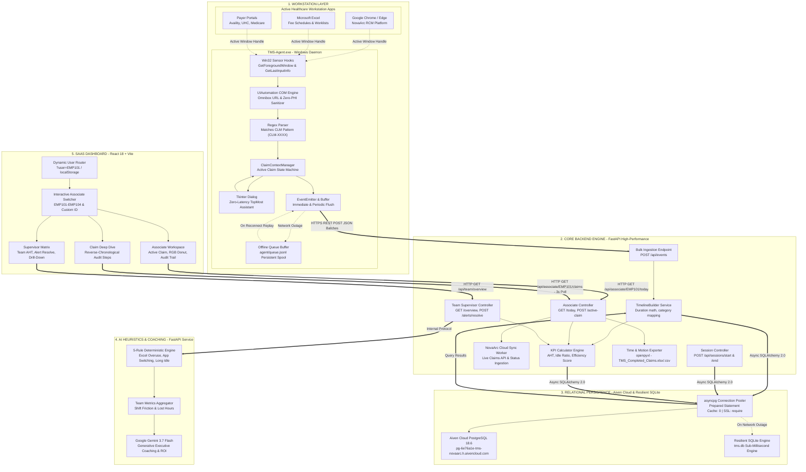
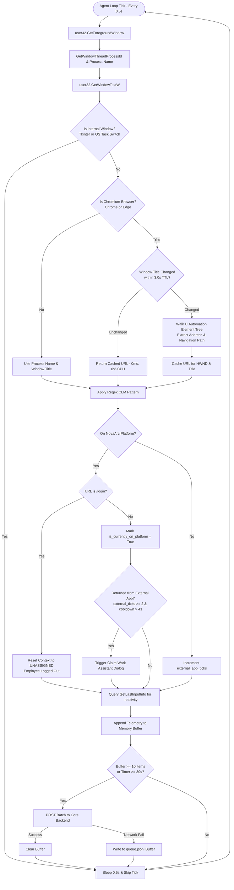
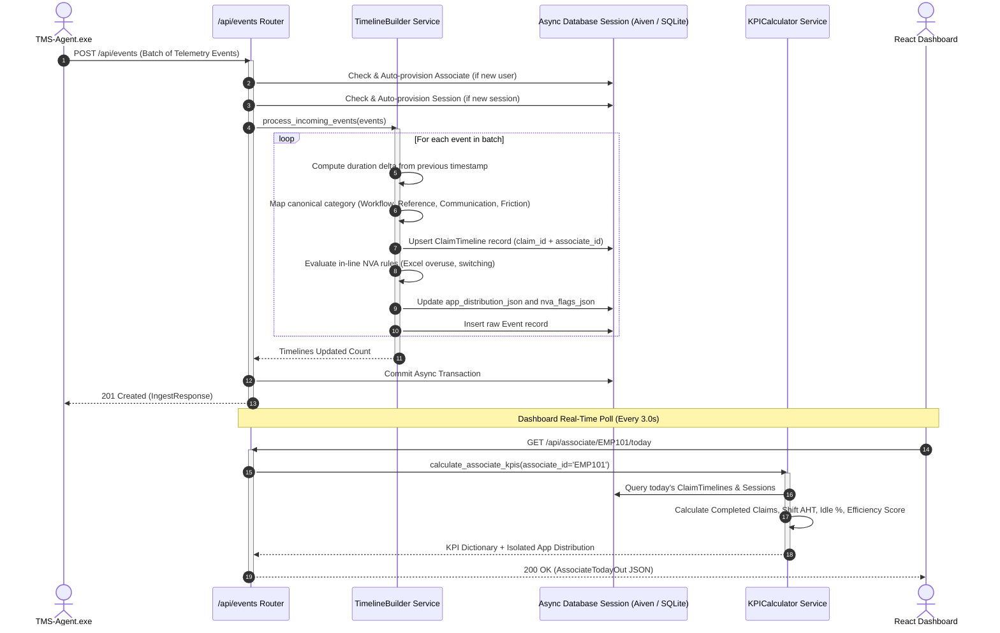
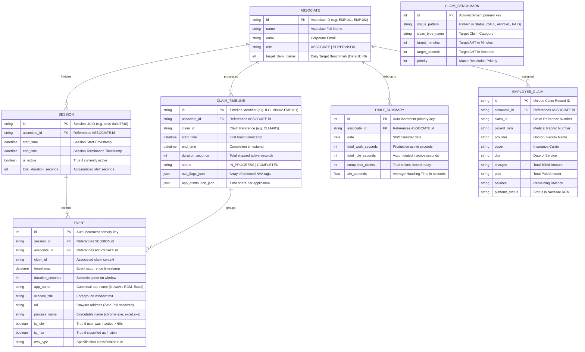
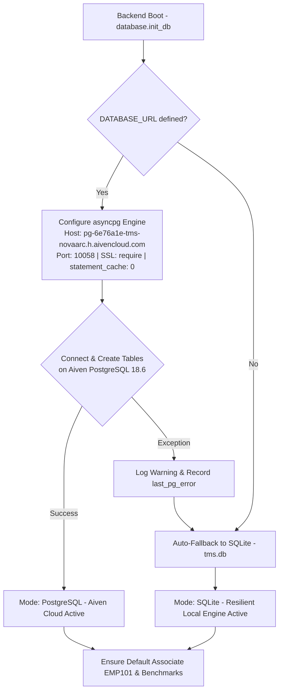
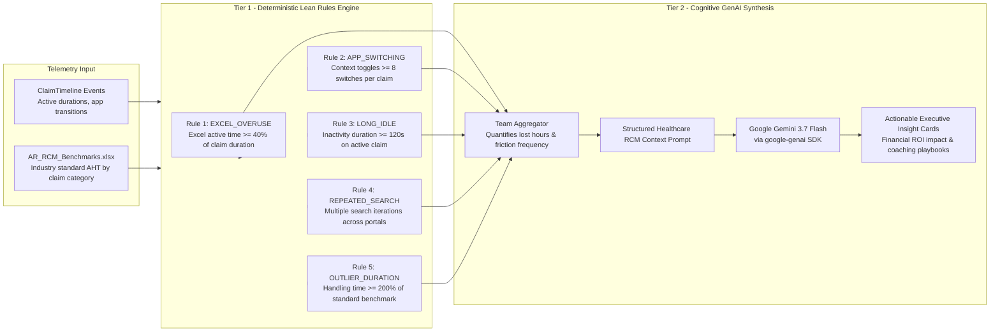
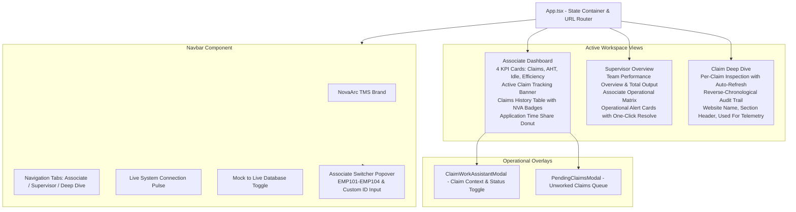

# NovaArc TMS - Comprehensive Architecture & System Design Dossier

> **Transaction Management System (TMS) & Effort Intelligence Platform for Revenue Cycle Management (AR Operations)**  
> *End-to-End Enterprise Architecture, Subsystem Designs, Data Models, Binary Packaging, and Execution Workflows*

---

## Table of Contents

1. [End-to-End System-Wide Architecture](#1-end-to-end-system-wide-architecture)
2. [Component 1: Desktop Telemetry Agent (TMS-Agent.exe)](#2-component-1-desktop-telemetry-agent-tms-agentexe)
   - [Agent Pipeline Diagram](#agent-pipeline-diagram)
   - [Detailed Operating Mechanics](#detailed-operating-mechanics)
   - [Anatomy of TMS-Agent.exe](#anatomy-of-tms-agentexe)
   - [Key Functions & Implementation Manifest](#agent-key-functions--implementation-manifest)
3. [Component 2: Backend Core API & Processing Engine (backend/)](#3-component-2-backend-core-api--processing-engine-backend)
   - [Backend Processing Flow Diagram](#backend-processing-flow-diagram)
   - [Detailed Operating Mechanics](#backend-operating-mechanics)
   - [NovaArc Platform Live Integration & Synchronization](#novaarc-platform-live-integration--synchronization)
   - [Key Functions & Implementation Manifest](#backend-key-functions--implementation-manifest)
4. [Component 3: Database & Relational Persistence Architecture (Aiven PostgreSQL & SQLite)](#4-component-3-database--relational-persistence-architecture)
   - [Entity-Relationship (ER) Diagram](#entity-relationship-er-diagram)
   - [Table Definitions & Schema Contracts](#table-definitions--schema-contracts)
   - [Aiven Cloud Managed PostgreSQL & Resilient Local Failover](#aiven-cloud-managed-postgresql--resilient-local-failover)
5. [Component 4: AI Reasoning & Friction Heuristics Engine (ai/)](#5-component-4-ai-reasoning--friction-heuristics-engine-ai)
   - [Dual-Tier Analytics Architecture](#dual-tier-analytics-architecture)
   - [The 5 Deterministic Lean NVA Rules](#the-5-deterministic-lean-nva-rules)
   - [Cognitive GenAI Synthesis via Google Gemini](#cognitive-genai-synthesis-via-google-gemini)
   - [Key Functions & Implementation Manifest](#ai-key-functions--implementation-manifest)
6. [Component 5: SaaS Web Dashboard Frontend (dashboard/)](#6-component-5-saas-web-dashboard-frontend-dashboard)
   - [Frontend Architecture & Component Tree](#frontend-architecture--component-tree)
   - [Multi-User Identity & State Synchronization](#multi-user-identity--state-synchronization)
   - [Live Tracking, Deep Dive & Fresh Start State](#live-tracking-deep-dive--fresh-start-state)
   - [Key Functions & Implementation Manifest](#frontend-key-functions--implementation-manifest)
7. [Comprehensive Project Folder Structure](#7-comprehensive-project-folder-structure)
8. [Full Technology Stack Matrix](#8-full-technology-stack-matrix)

---

## 1. End-to-End System-Wide Architecture

The TMS platform is comprised of five tightly coupled, highly responsive subsystems engineered specifically for high-throughput healthcare Revenue Cycle Management:

1. **Windows Desktop Telemetry Daemon (`TMS-Agent.exe`)**: Passively captures active window metadata, browser URLs via in-memory COM UIAutomation, and idle durations with <0.5% CPU footprint and 100% Zero-PHI compliance.
2. **FastAPI Core Backend Microservice (`tms-backend`)**: Ingests high-frequency telemetry, reconstructs claim timelines, calculates Novachron-standard KPIs (AHT, Idle Ratio, Efficiency Score), orchestrates live NovaArc status synchronization, and isolates multi-user claim states.
3. **Relational Persistence Layer (Aiven Managed PostgreSQL & Resilient Local SQLite)**: Enterprise cloud PostgreSQL database hosted on Aiven (`pg-6e76a1e-tms-novaarc.h.aivencloud.com:10058/defaultdb`) paired with an instant sub-millisecond local SQLite engine (`tms.db`) for zero-latency execution and automatic failover.
4. **FastAPI AI Intelligence Microservice (`tms-ai`)**: Executes 5 sub-millisecond Lean Non-Value-Added (NVA) heuristics and invokes Google Gemini 3.7 Flash for financial ROI quantification and supervisor coaching playbooks.
5. **React 18 + Vite SaaS Dashboard**: Real-time operational command center with live 3-second auto-polling, dynamic multi-associate switching, vibrant RGB time cycles, and reverse-chronological step-by-step Claim Deep Dive.



---

## 2. Component 1: Desktop Telemetry Agent (`TMS-Agent.exe`)

The Windows Desktop Agent acts as the sensory nervous system on each employee workstation. It operates completely in the background without requiring user clock-in or interrupting active billing operations.

### Agent Pipeline Diagram



### Detailed Operating Mechanics

#### 1. Zero-CPU Browser URL Inspection & Title Caching
- Traditional UIAutomation walkers recursively inspect thousands of DOM elements on the main thread, causing 15-30% CPU spikes and system freezes.
- TMS implements **`WindowTracker.get_browser_url()`** with a **3.0-second TTL cache** indexed by `(hwnd, window_title)`.
- If an associate is actively typing in a claim page and the window title has not changed, the URL returns in **0.0ms with 0% CPU consumption**.

#### 2. Claim ID Regex Extraction
- Extracted window titles and URLs are scanned with regex patterns (`CLM-\d{3,8}` and `CLM\d{3,8}`, e.g., `CLM-605`, `CLM-001`, `CLM-445522`).
- The matched ID is registered into the thread-safe `ClaimContextManager`.

#### 3. Cross-Application Context Locking
- When an associate switches away from NovaArc RCM to Microsoft Excel (to check fee schedules) or a clearinghouse portal (to check coverage), the agent retains the current active claim ID.
- Every second spent in external applications is attributed to that exact claim journey.

#### 4. Automatic NovaArc Authentication & Logout Detection
- **Sign-in**: When the URL changes from `/login` to `/` or any internal dashboard route, the agent immediately activates tracking and prompts the Claim Work Assistant.
- **Sign-out**: When the URL navigates back to `https://krishna-caare.github.io/novaarc-rcm/login`, the agent resets `has_logged_in_to_office = False`, clears active claim context, attributes subsequent activity to `UNASSIGNED`, and notifies the backend.

#### 5. Zero-Latency Dialog Trigger & Debounce Loop Guard
- The Claim Work Assistant pops up without white-box freeze or taskbar blocking:
  - If the user switches to external apps or returns, the dialog is presented cleanly using Win32 `SetWindowPos(HWND_TOPMOST)` without taking modal exclusive focus.
  - Clicking on the "Claims" shortcut minimizes the dialog and redirects to the NovaArc platform claims section.
  - Submitting or starting a claim immediately triggers live tracking in the dashboard.
- A strict 4.0-second debounce guard prevents intrusive popups if an associate rapidly switches windows during active typing.

#### 6. Dynamic Multi-User Identity Resolution
To support multi-user testing without cross-user data collision:
1. **CLI Flag**: `TMS-Agent.exe --associate EMP101`
2. **Environment Variable**: `TMS_ASSOCIATE_ID=EMP101`
3. **Local Text File**: `associate_id.txt` in the same directory
4. **Interactive Launcher**: `Start-Agent.bat` prompts the user on startup
5. **Machine Fallback**: `EMP-<WindowsUsername>` (e.g. `EMP-GOKUL`)

---

### Anatomy of `TMS-Agent.exe`

`TMS-Agent.exe` is a self-contained ~40.5 MB binary compiled via PyInstaller with zero external runtime dependencies:

```text
┌────────────────────────────────────────────────────────────────────────┐
│                        TMS-Agent.exe Structure                         │
├────────────────────────────────────────────────────────────────────────┤
│ 1. Windows C-Runtime Bootloader (runw.exe)                             │
│    - Headless entrypoint (no command prompt window spawned)            │
│    - Allocates memory and unpacks Python runtime to _MEIxxxxxx temp    │
├────────────────────────────────────────────────────────────────────────┤
│ 2. Python 3.11 / 3.14 Core Runtime                                     │
│    - python3.dll, python314.dll, base_library.zip                      │
│    - Complete standard library (asyncio, json, ssl, time, threading)   │
├────────────────────────────────────────────────────────────────────────┤
│ 3. Native Windows C-Extensions & Drivers                               │
│    - pywin32 (win32gui, win32process, win32con, win32api)              │
│    - comtypes (UIAutomation COM interfaces for Chrome / Edge)          │
│    - psutil (process hierarchy and resource footprint monitoring)      │
│    - _tkinter, tcl86t.dll, tk86t.dll (native OS dialog system)         │
│    - requests, urllib3, cryptography, certifi (SSL/TLS HTTPS stack)    │
│    - pystray, PIL (system tray icon and notification manager)          │
├────────────────────────────────────────────────────────────────────────┤
│ 4. Bundled Data Contracts & Configurations                             │
│    - config.json (Default poll interval: 0.5s, local & cloud endpoints)│
│    - shared/app-map.json (Process-to-Application canonical dictionary) │
├────────────────────────────────────────────────────────────────────────┤
│ 5. Compiled Application Bytecode                                       │
│    - main.pyc (Master daemon loop and identity resolver)               │
│    - tracker.pyc (Window tracking, UIAutomation, caching, and filter)  │
│    - idle_monitor.pyc (User inactivity and mouse tick detection)       │
│    - claim_context.pyc (Active claim state machine)                    │
│    - emitter.pyc (Batch buffer and offline disk queue drainer)         │
│    - dialog.pyc (Tkinter manual claim entry UI with claims redirect)   │
│    - tray.pyc (System tray background management)                      │
└────────────────────────────────────────────────────────────────────────┘
```

### Agent Key Functions & Implementation Manifest

| Component | Function / Class | Source File | Description |
| :--- | :--- | :--- | :--- |
| **Identity** | [`resolve_associate_identity()`](file:///b:/Projects/TMS_full_working/TMS/agent/main.py) | `agent/main.py` | Priority-based associate identity resolver (CLI > Env > Text > Config > Machine). |
| **Tracking** | [`WindowTracker.get_active_window()`](file:///b:/Projects/TMS_full_working/TMS/agent/tracker.py) | `agent/tracker.py` | Retrieves active window handle, process name, and canonical application name. |
| **URL Extraction** | [`WindowTracker.get_browser_url()`](file:///b:/Projects/TMS_full_working/TMS/agent/tracker.py) | `agent/tracker.py` | Extracts URL using UIAutomation with 3.0s `(hwnd, title)` cache TTL for 0% CPU. |
| **Filter** | [`is_internal_agent_window()`](file:///b:/Projects/TMS_full_working/TMS/agent/tracker.py) | `agent/tracker.py` | Detects and filters out Tkinter dialogs, task switchers, and OS flickers. |
| **Idle Monitor** | [`IdleMonitor.get_idle_seconds()`](file:///b:/Projects/TMS_full_working/TMS/agent/idle_monitor.py) | `agent/idle_monitor.py` | Measures user keyboard/mouse inactivity using `GetLastInputInfo`. |
| **Context State** | [`ClaimContextManager.set_manual_claim()`](file:///b:/Projects/TMS_full_working/TMS/agent/claim_context.py) | `agent/claim_context.py` | Thread-safe active claim context state manager. |
| **Telemetry** | [`EventEmitter.emit()` & `flush()`](file:///b:/Projects/TMS_full_working/TMS/agent/emitter.py) | `agent/emitter.py` | Buffers events and executes resilient HTTP batch posts with disk spool fallback. |
| **Master Daemon** | [`AgentDaemon.run()`](file:///b:/Projects/TMS_full_working/TMS/agent/main.py) | `agent/main.py` | Main 0.5s polling loop coordinating sensors, dialogs, logout, and flusher. |

---

## 3. Component 2: Backend Core API & Processing Engine (`backend/`)

The Core Backend receives real-time telemetry from desktop agents and serves analytical endpoints to the executive dashboard.

### Backend Processing Flow Diagram



### Backend Operating Mechanics

#### 1. Just-in-Time Auto-Provisioning
- When a new associate launches `TMS-Agent.exe` with ID `EMP101` or `EMP-USERB`, the backend automatically provisions a record in the `associates` table with role `ASSOCIATE`.
- Prevents foreign key constraint failures and requires zero manual database maintenance.

#### 2. Timeline Slicing & Categorization
- Telemetry events are reassembled into continuous chronological timelines.
- Each application visit is classified into healthcare operational categories:
  - **Workflow Systems**: Primary platforms (NovaArc RCM, Epic, Cerner)
  - **Reference Tools**: Payer portals (Availity, UHC, Medicare)
  - **Offline Tools**: Microsoft Excel (worklists, fee schedules)
  - **Friction**: Untracked apps, personal browsing, or excessive idle time

#### 3. Real-Time Multi-User Claim Overrides
- When an associate confirms a claim in the Claim Work Assistant dialog or on the web dashboard, the backend stores an active claim override in `ACTIVE_CLAIM_OVERRIDE[associate_id]`.
- This ensures User A working on `CLM-605` and User B working on `CLM-001` are 100% isolated and never overwrite each other.

### NovaArc Platform Live Integration & Synchronization

The backend integrates directly with the NovaArc healthcare claims platform:
- **Instant Status Auto-Update**: When a user updates the status or claim type of a claim in NovaArc (e.g. from `DENIED` to `RESUBMIT CLAIM (CALL/IVR)`), the change is automatically detected, updating the target benchmark and recalculating AHT in real time.
- **Dynamic New Claim Ingestion**: Newly created claims entered into the dialog box are immediately validated against NovaArc, registered into `employee_claims`, and initiated for live tracking without delay.
- **Automated Excel & CSV Synchronization**: Whenever a claim completes, `TMS_Completed_Claims.xlsx` and `TMS_Completed_Claims.csv` are appended synchronously, guaranteeing 100% data alignment between dashboard KPIs and downloaded reports.

### Backend Key Functions & Implementation Manifest

| Component | Function / Class | Source File | Description |
| :--- | :--- | :--- | :--- |
| **Ingestion** | [`ingest_events()`](file:///b:/Projects/TMS_full_working/TMS/backend/routes/events.py) | `backend/routes/events.py` | High-throughput bulk ingestion endpoint for desktop agents. |
| **Timeline Engine** | [`process_incoming_events()`](file:///b:/Projects/TMS_full_working/TMS/backend/services/timeline_builder.py) | `backend/services/timeline_builder.py` | Converts raw heartbeats into duration-sliced `ClaimTimeline` entries. |
| **KPI Engine** | [`calculate_associate_kpis()`](file:///b:/Projects/TMS_full_working/TMS/backend/services/kpi_calculator.py) | `backend/services/kpi_calculator.py` | Computes completed claims, AHT, idle ratio, efficiency score, and app distribution. |
| **Session API** | [`start_session()` & `end_session()`](file:///b:/Projects/TMS_full_working/TMS/backend/routes/sessions.py) | `backend/routes/sessions.py` | Controls shift lifecycle and auto-provisions active session IDs. |
| **Claim Sync** | [`set_active_claim()`](file:///b:/Projects/TMS_full_working/TMS/backend/routes/associate.py) | `backend/routes/associate.py` | Sets real-time active claim context per associate with multi-user isolation. |
| **Claim Closure** | [`complete_claim()`](file:///b:/Projects/TMS_full_working/TMS/backend/routes/associate.py) | `backend/routes/associate.py` | Marks claim `COMPLETED` and appends row to `TMS_Completed_Claims.xlsx` & `.csv`. |
| **Supervisor** | [`get_team_overview()`](file:///b:/Projects/TMS_full_working/TMS/backend/routes/team.py) | `backend/routes/team.py` | Aggregates operational team matrix, active claim statuses, and team-wide AHT. |
| **Diagnostics** | [`db_status()`](file:///b:/Projects/TMS_full_working/TMS/backend/main.py) | `backend/main.py` | Verifies database connection, masked URL, active engine type, and table counts. |

---

## 4. Component 3: Database & Relational Persistence Architecture

### Entity-Relationship (ER) Diagram



### Table Definitions & Schema Contracts

1. **`associates`**: Stores associate profile, role, and daily productivity targets.
2. **`sessions`**: Tracks continuous agent tracking sessions, connection timestamps, and duration.
3. **`claim_timelines`**: Aggregates all work touches on a specific claim into an analytical unit with duration, status, and NVA friction tags.
4. **`events`**: High-frequency raw audit log recording individual window activations, URLs, and idle flags.
5. **`employee_claims`**: Active and completed claims assigned to associates with live NovaArc platform status and financial data.
6. **`claim_benchmarks`**: Standard AHT targets mapped to claim categories and platform status patterns.
7. **`daily_summaries`**: Daily rollup table for fast historical reporting and supervisor trend analytics.

---

### Aiven Cloud Managed PostgreSQL & Resilient Local Failover



#### Connection Safeguards
- **Aiven Cloud Hosted**: Enterprise PostgreSQL 18.6 managed instance (`pg-6e76a1e-tms-novaarc.h.aivencloud.com:10058/defaultdb`).
- **SSL Enforcement**: Configured with `sslmode=require` and TLS certificate handling.
- **Statement Cache Handling**: AsyncPG prepares statements by default. For cloud pooler safety, `prepared_statement_cache_size=0` ensures stable long-lived connections.
- **Zero-Downtime Local Failover**: If network connectivity drops or the cloud database is unreachable, the backend seamlessly switches to `./tms.db` without throwing unhandled exceptions.

---

## 5. Component 4: AI Reasoning & Friction Heuristics Engine (`ai/`)

The AI engine operates on a two-tier model: sub-millisecond deterministic rules for real-time tagging, combined with Google Gemini for executive coaching and ROI quantification.

### Dual-Tier Analytics Architecture



### The 5 Deterministic Lean NVA Rules

| Rule ID | Name | Trigger Condition | Healthcare Operational Root Cause |
| :--- | :--- | :--- | :--- |
| **Rule 1** | `EXCEL_OVERUSE` | $\ge 40\%$ of total claim duration spent in Excel | Associate is manually reconciling fee schedules or contract terms outside the EHR. |
| **Rule 2** | `APP_SWITCHING` | $\ge 8$ application context toggles on a single claim | Fragmented workflow requiring cross-verification between multiple payer portals and clearinghouses. |
| **Rule 3** | `LONG_IDLE` | $\ge 120$ seconds of continuous inactivity | Associate is waiting on hold with payer phone representative or clearinghouse service delay. |
| **Rule 4** | `REPEATED_SEARCH` | Multiple search iterations for the same claim/patient | Suboptimal search indexes or incorrect patient identifier provided on original billing sheet. |
| **Rule 5** | `OUTLIER_DURATION` | Total duration $\ge 200\%$ of standard benchmark AHT | Complex denial dispute, missing medical necessity documentation, or appeal filing. |

### AI Key Functions & Implementation Manifest

| Component | Function / Class | Source File | Description |
| :--- | :--- | :--- | :--- |
| **Rules Engine** | [`evaluate_claim_nva()`](file:///b:/Projects/TMS_full_working/TMS/ai/rules.py) | `ai/rules.py` | Evaluates a `ClaimTimeline` against all 5 deterministic Lean heuristics. |
| **Aggregation** | [`aggregate_team_metrics()`](file:///b:/Projects/TMS_full_working/TMS/ai/aggregator.py) | `ai/aggregator.py` | Rolls up friction frequencies, calculates total lost hours, and groups bottlenecks. |
| **GenAI Inference** | [`generate_actionable_insights()`](file:///b:/Projects/TMS_full_working/TMS/ai/engine.py) | `ai/engine.py` | Invokes Google Gemini 3.7 Flash with TTL caching to produce executive coaching cards. |

---

## 6. Component 5: SaaS Web Dashboard Frontend (`dashboard/`)

The SaaS Web Dashboard is built with React 18, Vite, and a custom 2D Sharp Design System. It communicates with the FastAPI backend via high-speed auto-polling hooks.

### Frontend Architecture & Component Tree



### Multi-User Identity & State Synchronization

1. **URL Parameter Routing**: The dashboard checks `?user=EMP101` or `?associate=EMP101`. If present, it sets `selectedAssociateId` and syncs with `localStorage`.
2. **Associate Switcher**: In the navbar, users can click the associate badge to pick standard team members (`EMP101` to `EMP104`) or type any custom ID.
3. **URL Sharing**: Switching associates automatically calls `window.history.replaceState` with `?user=<ID>`, allowing direct bookmarked links for different workstation users.
4. **Independent Live Polling**: Built via [`useLivePolling()`](file:///b:/Projects/TMS_full_working/TMS/dashboard/src/hooks/useLivePolling.ts), the dashboard auto-refreshes every 3 seconds for immediate multi-user tracking.

### Live Tracking, Deep Dive & Fresh Start State

- **Immediate Live Tracking**: Upon clicking "Start Working" in the dialog box, telemetry streams directly into the dashboard. Active claim duration ticks up in real time, and the active claim banner highlights current progress.
- **Claim Deep Dive**: Renders every individual workflow step in reverse chronological order (newest on top) with website name, section header, operational intent ("Used For"), and active duration.
- **Fresh Baseline (Zero Mock Data)**: All mock data fixtures have been purged (`dashboard/src/api/mock.ts` starts with 0 completed claims, 0.0m AHT, and empty history). The dashboard renders pristine live data exclusively from the database.

### Frontend Key Functions & Implementation Manifest

| Component | Function / Hook | Source File | Description |
| :--- | :--- | :--- | :--- |
| **State Router** | [`getInitialAssociateId()`](file:///b:/Projects/TMS_full_working/TMS/dashboard/src/App.tsx) | `dashboard/src/App.tsx` | Resolves associate identity from URL parameters (`?user=...`) or `localStorage`. |
| **Switcher** | [`handleSelectAssociate()`](file:///b:/Projects/TMS_full_working/TMS/dashboard/src/App.tsx) | `dashboard/src/App.tsx` | Updates state, syncs URL query string, and updates `localStorage`. |
| **Navbar Switcher** | [`Navbar`](file:///b:/Projects/TMS_full_working/TMS/dashboard/src/components/Navbar.tsx) | `dashboard/src/components/Navbar.tsx` | Interactive dropdown popover with presets and custom ID input. |
| **Live Polling** | [`useLivePolling()`](file:///b:/Projects/TMS_full_working/TMS/dashboard/src/hooks/useLivePolling.ts) | `dashboard/src/hooks/useLivePolling.ts` | 3-second auto-polling hook with countdown and auto-pause on window blur. |
| **API Client** | [`api.getAssociateToday()`](file:///b:/Projects/TMS_full_working/TMS/dashboard/src/api/client.ts) | `dashboard/src/api/client.ts` | Asynchronous REST client communicating with backend endpoints. |
| **Deep Dive** | [`ClaimDeepDive`](file:///b:/Projects/TMS_full_working/TMS/dashboard/src/pages/ClaimDeepDive.tsx) | `dashboard/src/pages/ClaimDeepDive.tsx` | Per-claim step-by-step audit inspector with dynamic associate isolation. |

---

## 7. Comprehensive Project Folder Structure

```text
TMS/
│
├── .github/                            # CI/CD Workflows & Repository Templates
│   └── workflows/                      # GitHub Actions automated builds
│
├── .planning/                          # Product Management & GSD Planning Specs
│   ├── PROJECT.md                      # Project definition & core roadmap
│   ├── REQUIREMENTS.md                 # User requirements & acceptance criteria
│   ├── STATE.md                        # Current execution & milestone state
│   └── codebase/                       # Architectural dossiers & design notes
│       └── ARCHITECTURE.md             # Planning architecture snapshot
│
├── agent/                              # DESKTOP TELEMETRY AGENT (Windows Daemon)
│   ├── main.py                         # Master daemon loop, CLI args & identity resolver
│   ├── tracker.py                      # Win32 foreground window & COM UIAutomation URL tracker
│   ├── dialog.py                       # Tkinter Claim Work Assistant modal & NovaArc redirect
│   ├── claim_context.py                # Thread-safe active claim context state machine
│   ├── idle_monitor.py                 # Win32 GetLastInputInfo user inactivity sensor
│   ├── emitter.py                      # Telemetry event batcher & queue.jsonl disk buffer
│   ├── tray.py                         # Windows system tray icon & background runner
│   ├── config.json                     # Agent configuration, poll rate & backend endpoints
│   ├── associate_id.txt                # Workspace associate identity override file
│   └── README.md                       # Dedicated agent documentation & setup guide
│
├── backend/                            # CORE ANALYTICS BACKEND (FastAPI Microservice)
│   ├── main.py                         # FastAPI application entrypoint, CORS & lifecycle
│   ├── database.py                     # Async SQLAlchemy engine (Aiven PostgreSQL / SQLite)
│   ├── models.py                       # Relational database models (7 tables)
│   ├── schemas.py                      # Pydantic request/response validation schemas
│   ├── .env                            # Database connection string & cloud environment config
│   ├── routes/                         # REST API Route Controllers
│   │   ├── events.py                   # POST /api/events (High-throughput ingestion)
│   │   ├── associate.py                # GET /today, POST /active-claim, POST /complete
│   │   ├── sessions.py                 # POST /api/sessions/start & /end
│   │   ├── team.py                     # GET /api/team/overview, /export-tm
│   │   └── ai_proxy.py                 # GET /api/insights (AI service gateway)
│   ├── services/                       # Business Logic & Analytics Services
│   │   ├── kpi_calculator.py           # Novachron KPI formulas (AHT, Efficiency, Idle)
│   │   ├── timeline_builder.py         # Chronological event slicing & NVA tagging
│   │   └── excel_exporter.py           # Automated openpyxl Time & Motion spreadsheet generator
│   └── README.md                       # Dedicated backend documentation & setup guide
│
├── ai/                                 # AI INTELLIGENCE & HEURISTICS (FastAPI Microservice)
│   ├── main.py                         # FastAPI microservice entrypoint (Port 8001)
│   ├── nva_engine.py                   # 5 Deterministic Lean Non-Value-Added friction rules
│   ├── team_aggregator.py              # Team bottleneck, shift friction & lost hours rollup
│   ├── gemini_insights.py              # Google Gemini 3.7 Flash executive coaching generator
│   ├── rules.py                        # Rule definitions & evaluation logic
│   ├── aggregator.py                   # Metrics aggregation helper
│   ├── engine.py                       # GenAI pipeline coordinator with TTL cache
│   └── README.md                       # Dedicated AI documentation & setup guide
│
├── dashboard/                          # SAAS WEB DASHBOARD (React 18 + Vite + TypeScript)
│   ├── src/
│   │   ├── api/                        # API client, interface types & pristine mock defaults
│   │   │   ├── client.ts               # Asynchronous REST client with failover
│   │   │   ├── types.ts                # TypeScript interfaces matching backend models
│   │   │   └── mock.ts                 # Clean zero-baseline mock fixtures
│   │   ├── components/                 # Reusable UI Components
│   │   │   ├── Navbar.tsx              # Top navigation, live pulse & associate switcher
│   │   │   ├── ClaimWorkAssistantModal.tsx # Web modal for manual claim assignment & status
│   │   │   ├── PendingClaimsModal.tsx  # Unworked queue inspector
│   │   │   └── ...                     # KPI cards, charts & modal dialogs
│   │   ├── pages/                      # Application Workspace Pages
│   │   │   ├── AssociateDashboard.tsx  # Associate KPIs, active claim banner & time share
│   │   │   ├── SupervisorDashboard.tsx # Team performance matrix, alerts & T&M downloads
│   │   │   └── ClaimDeepDive.tsx       # Reverse-chronological audit steps inspector
│   │   ├── hooks/                      # Custom React Hooks
│   │   │   └── useLivePolling.ts       # 3-second auto-poll hook with pause on blur
│   │   ├── App.tsx                     # Main state container & query parameter routing
│   │   └── main.tsx                    # React DOM entrypoint
│   ├── package.json                    # Node dependencies (React, Vite, Lucide, Tailwind)
│   └── README.md                       # Dedicated dashboard documentation & build guide
│
├── shared/                             # CANONICAL SHARED CONTRACTS
│   ├── event-schema.json               # JSON Schema Draft-07 contract for agent telemetry
│   ├── app-map.json                    # Executable process name to canonical app mapping
│   └── README.md                       # Shared standards documentation
│
├── Project_Requirements/               # SPECIFICATIONS & REFERENCE BENCHMARKS
│   └── Prev Entd Voice T&M.xlsx        # Baseline legacy Time & Motion template
│
├── AR_RCM_Benchmarks.xlsx              # Industry standard AHT benchmarks by claim category
├── NovaChron_KPI_Formula_Specification.pdf # Official KPI formula definitions & rules
├── TMS_Completed_Claims.xlsx           # Live Time & Motion Excel report (15-column format)
├── TMS_Completed_Claims.csv            # Live Time & Motion companion CSV report
├── TMS-Agent.exe                       # Standalone packaged Windows desktop daemon binary
├── TMS-Agent.spec                      # PyInstaller compilation specification
├── TMS-Agent-Windows.zip               # Distributable portable archive for Windows clients
├── Start-Agent.bat                     # Interactive Windows launcher with associate ID prompt
├── Start-Agent-Silent.vbs              # Background invisible VBS launcher (zero command prompt)
├── Stop-Agent.bat                      # Graceful shutdown script for background agent processes
├── verify_core.py                      # Centralized multi-subsystem integrity test suite
├── HOW_TO_RUN.txt                      # Step-by-step local execution instructions
├── requirements.txt                    # Unified Python dependency manifest
├── ARCHITECTURE.md                     # Comprehensive Architecture & System Design Dossier
└── README.md                           # Master Project Documentation & Executive Blueprint
```

---

## 8. Full Technology Stack Matrix

| Domain | Technology / Package | Version | Purpose in Architecture |
| :--- | :--- | :--- | :--- |
| **Desktop Client** | **Python** | 3.11 / 3.14 | Core daemon execution environment |
|  | **PyInstaller** | 6.22.3 | Standalone zero-dependency `.exe` compiler |
|  | **pywin32** | 312 | Win32 API hooks (`GetForegroundWindow`, `GetLastInputInfo`) |
|  | **comtypes** | 1.4.16 | UIAutomation COM interfaces for browser URL inspection |
|  | **psutil** | 7.2.2 | Process ID extraction and system footprint monitoring |
|  | **Tkinter** | Standard | Lightweight OS-native Claim Work Assistant fallback dialog |
|  | **Requests / urllib3** | 2.34.2 | Robust HTTPS client for batch telemetry delivery |
| **Core Backend** | **FastAPI** | 0.142.2 | High-throughput asynchronous REST microservice framework |
|  | **Uvicorn** | 0.54.0 | ASGI web server (running on port 8000) |
|  | **SQLAlchemy** | 2.0.52 | Asynchronous Object-Relational Mapping (AsyncIO) |
|  | **Pydantic** | 2.13.5 | Strict input validation schemas and response serialization |
|  | **openpyxl** | 3.1.5 | Automated 15-column Time & Motion Excel export generation |
| **AI Microservice** | **Google Gemini** | 3.7 Flash | Large Language Model for executive pattern synthesis & ROI |
|  | **google-genai** | 2.29.0 | Official Google GenAI Python SDK |
|  | **Pandas** | 3.0.5 | AR Benchmark data manipulation and tabular analysis |
| **Persistence** | **Aiven PostgreSQL** | 18.6 Cloud | Enterprise Managed PostgreSQL cloud database |
|  | **asyncpg** | 0.29.0 | High-performance asynchronous PostgreSQL driver |
|  | **aiosqlite** | 0.22.1 | Asynchronous SQLite driver for zero-latency redundant failover |
| **Web Dashboard** | **React** | 18.3.1 | Component-driven user interface library |
|  | **TypeScript** | 5.5.3 | Static type safety and data contract synchronization |
|  | **Vite** | 5.4.21 | Next-generation frontend build tooling and dev server |
|  | **Lucide React** | 0.344.0 | Healthcare and operational interface iconography |
| **Automation & Ops** | **GitHub Actions** | CI/CD | Automated verification, bundling, and multi-branch synchronization |
|  | **Batch / VBScript** | Native | Headless client management (`Start-Agent.bat`, `Start-Agent-Silent.vbs`) |
