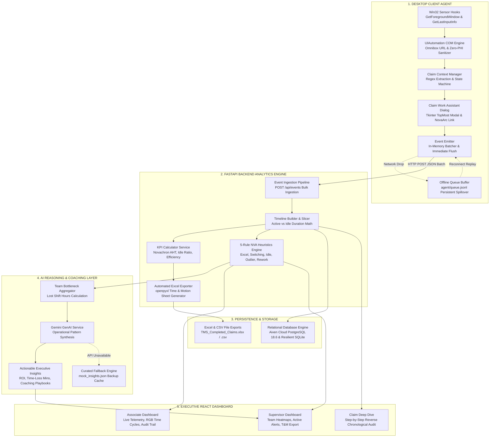
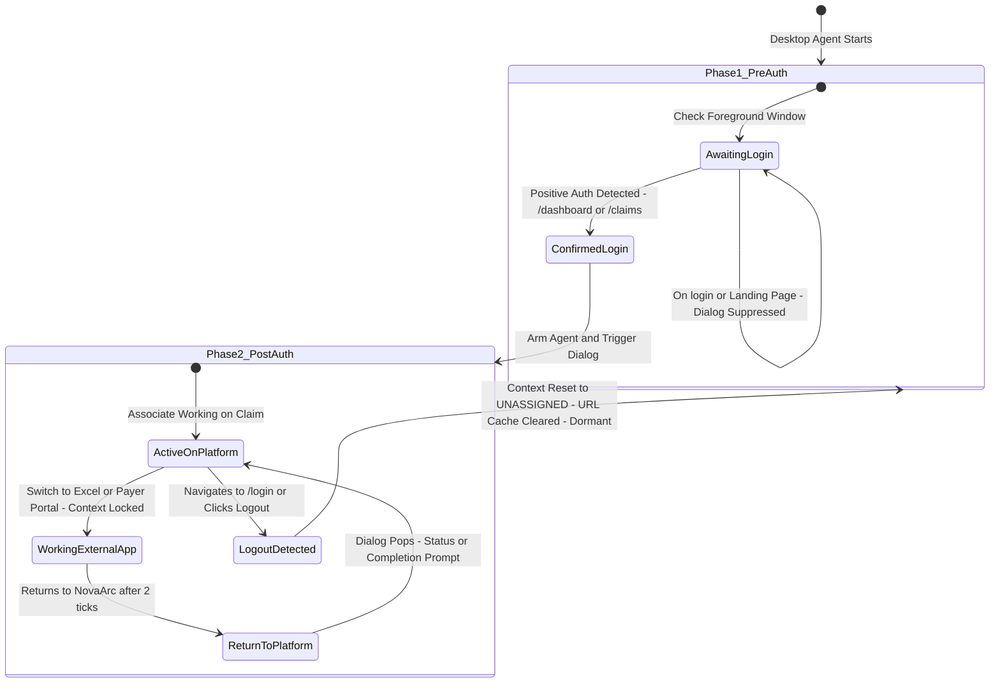

# Transaction Management System (TMS)

> **AI-Powered Telemetry and Effort Intelligence for Revenue Cycle Management**  
> *Enterprise MVP Foundation for Accounts Receivable (AR) Operations*  
> 🏛️ **[Complete Architecture & System Design Dossier](file:///b:/Projects/TMS_full_working/TMS/ARCHITECTURE.md)** — *Full End-to-End Mermaid Diagrams, Component Deep-Dives, Binary Anatomy, Database Models & Tech Stack Matrix*

---

## 1. Executive Summary

In healthcare Revenue Cycle Management (RCM), Accounts Receivable (AR) associates spend their shifts processing complex medical claims across diverse, disconnected applications:

* **Primary Billing Platforms**: NovaArc RCM, ClaimPlatform, Epic, Cerner
* **Payer Portals**: Availity, UnitedHealthcare, Medicare portals accessed via Chrome and Edge
* **Offline Worksheets**: Microsoft Excel workbooks for fee schedules, contract terms, and modifier lookups
* **Communication & Documentation**: Outlook, Microsoft Teams, and Adobe Acrobat

### The Core Operational Problem

Operations executives and team managers lack objective, granular visibility into actual claim handling effort. Traditional time studies rely on manual stopwatches or self-reported logs, distorting actual associate handling times, introducing severe observer bias, and wasting 15% to 20% of productive shift capacity on administrative reporting. Furthermore, simple window-tracking utilities fail because resolving a single claim requires fluid multitasking across 3 to 5 applications simultaneously.

### The TMS Solution: Active Claim Context Tracking

TMS solves this through **Active Claim Context Tracking**:

1. **Automatic Context Detection**: When an associate selects a claim in their billing software, the desktop daemon detects the claim identifier (`CLM-605`, `CLM-001`) from the foreground window header or browser URL.
2. **Context Locking Across Applications**: The agent locks that claim's context. Subsequent application switches (such as checking fee schedules in Excel or verifying coverage on a payer web portal) are automatically attributed to the active claim.
3. **Interactive Claim Assistant**: A lightweight, zero-latency desktop assistant lets associates enter claims, review status, view benchmark AHT, jump directly to NovaArc's claims section, and start tracking immediately.
4. **Automated Time Slicing & Excel Generation**: The backend reassembles raw telemetry heartbeats into continuous timelines, calculates active vs. idle duration, and automatically synchronizes completed claims into a standard 15-column Time & Motion report (`TMS_Completed_Claims.xlsx` and companion CSV).
5. **Two-Tier Intelligence**: Sub-millisecond deterministic Lean heuristics flag operational friction (such as Excel overuse or excessive context switching), while Google Gemini 3.7 Flash analyzes aggregate team patterns to calculate financial ROI impact and provide personalized coaching recommendations.
6. **3-Pillar Zero-PHI Navigation Tracking**: Tracks and surfaces Website Name, Inside Section Header, and Healthcare Operational Purpose ("Used For") for every portal and EHR page in Claim Deep Dive via an air-gapped Zero-PHI local catalog.

---

## 2. Core Solution Blueprint: The "Why", "How", "Where" & Development Methodology

### System Architecture Overview Diagram



### How the Core Layers Work Together

1. **Desktop Client Agent (Sensory Nervous System on Windows)**  
   Runs in the background of each associate workstation with `< 0.5%` CPU utilization. Win32 sensor hooks capture window switches and idle durations without recording keystrokes or screen contents (100% HIPAA compliant). The Claim Context Manager isolates claim IDs using regex and attributes multi-app activity to the active claim. The Claim Work Assistant provides zero-latency manual entry, status toggling, and clean claim closure, while the Event Emitter batches telemetry with an offline disk queue (`queue.jsonl`).

2. **FastAPI Backend Analytics Engine (Central Processing Hub)**  
   Ingests structured JSON telemetry batches, reconstructs raw window visits into unified chronological claim journeys, slices active vs. idle seconds, evaluates 5 deterministic Lean NVA rules, and synchronously appends completed claims into `TMS_Completed_Claims.xlsx` and `TMS_Completed_Claims.csv` matching the standard 15-column healthcare Time & Motion format.

3. **Persistence Layer (Aiven Cloud Managed PostgreSQL & Resilient SQLite)**  
   All transactions, events, and claims are securely stored in a high-performance managed PostgreSQL instance hosted on Aiven (`pg-6e76a1e-tms-novaarc.h.aivencloud.com:10058/defaultdb`), backed by automatic failover to local SQLite (`tms.db`).

4. **AI Reasoning & Coaching Layer (Cognitive Intelligence Brain)**  
   Evaluates aggregate shift-level metrics across the associate team. Google Gemini 3.7 Flash synthesizes operational patterns into financial ROI metrics, quantifies non-productive hours, identifies underlying system friction, and generates tailored coaching playbooks for team supervisors.

5. **Executive React Dashboard (Real-Time Command Center)**  
   Provides dedicated workspaces for associates and supervisors. Associates track shift targets, view isolated claim-specific RGB application time share cycles, and review recent activity in reverse chronological order. Supervisors monitor team Average Handling Time (AHT), active/idle statuses, live friction banners, and one-click Time & Motion downloads.

---

## 3. Solution Method Comparison: Why Win32 + UIAutomation vs. Alternatives

During architectural evaluation, four candidate methods were analyzed for workstation telemetry and live tracking. The comparison below illustrates why TMS selected **Method 1 (Win32 OS Hooks + In-Memory UIAutomation)**:

| Evaluation Dimension | Method 1: Win32 + UIAutomation (Selected TMS Solution) | Method 2: Browser Extensions (Chrome / Edge WebExtensions) | Method 3: Local Network Proxy (mitmproxy / Fiddler / WinINet) | Method 4: Screen Capture + OCR (Tesseract / Vision AI) |
| :--- | :--- | :--- | :--- | :--- |
| **CPU & Memory Overhead** | **`< 0.5% CPU`, `< 35 MB RAM`** (Ultra-low footprint) | Moderate (`2% - 5% CPU` per tab, `150+ MB RAM`) | High (`4% - 8% CPU`, TLS decryption overhead) | Very High (`15% - 40% CPU`, GPU spikes, high battery drain) |
| **Cross-Application Coverage** | **100% Full Desktop** (Tracks NovaArc, Chrome, Edge, Excel, EHRs, Notepad, Teams) | **Browser Only** (Completely blind to Excel workbooks, desktop EHRs, Citrix, PDF viewers) | **Network Only** (Tracks HTTP traffic, but blind to local Excel calculations, offline tools) | Full Desktop (Sees entire display, but fails on blurred/small fonts and occluded windows) |
| **Zero-PHI & HIPAA Compliance** | **Air-Gapped Metadata Only** (Never touches patient text, DOM contents, or form fields) | High Risk (Extension has full DOM access to patient records, SSNs, credit cards) | Severe Risk (Decrypts all TLS healthcare packets; requires local root CA installation) | High Risk (Captures full screen pixels containing patient names, medical history) |
| **Enterprise IT Deployment** | **Zero-Dependency `.exe`** (Single binary run via silent VBS or batch; zero store approvals) | Complex (Requires Chrome Web Store approval, enterprise GPO extension whitelisting) | Prohibitive (Enterprise infosec forbids untrusted root certificates on workstations) | Complex (Heavy binary dependencies: OpenCV, Tesseract OCR engines, multi-GB models) |
| **Latency & Sampling Speed** | **`< 1 millisecond`** (Deterministic Windows message pump) | Variable (`50ms - 250ms`, dependent on tab JS event loop) | Added Network Delay (`5ms - 20ms` per HTTP transaction) | Slow (`500ms - 2000ms` per OCR inference frame) |
| **Reliability on SPA Navigation** | **High** (Omnibox accessibility events reflect client-side route changes) | High (Intercepts HTML5 history API) | Poor (Single-page app route changes do not make new server HTTP requests) | Poor (Lagging frames fail during fast switching) |

**Architectural Conclusion**: Method 1 provides the highest fidelity, lowest latency, zero PHI risk, and universal cross-application coverage without requiring browser extensions or network MITM configurations.

---

## 4. Claim Work Assistant Dialog Box Triggering Architecture

A core design requirement of TMS is ensuring that the associate is **prompted to assign or complete their claim context at the exact moment of work**, while strictly avoiding premature interruptions or focus-stealing loops.



- **Phase 1: Pre-Authentication (Sign-In Screen)**:
  - While the employee is on the NovaArc login screen, the dialog is **strictly suppressed**. The agent remains silent, awaiting employee sign-in.
- **Positive Sign-In Confirmation**:
  - As soon as the user logs in and navigates to an authenticated route (`/dashboard`, `/claims`), the agent immediately arms, logs `NOVAARC PLATFORM SIGN-IN CONFIRMED`, and presents the Claim Work Assistant dialog with zero lag.
- **Zero-Freeze Focus Management**:
  - If the user switches away to another application before the dialog finishes initializing, the dialog does not block the Windows taskbar or produce an empty white box. It appears cleanly atop the screen when NovaArc is in focus.
- **Claims Section Deep Link**:
  - Clicking on the "Claims" link in the dialog minimizes the popup and redirects the browser directly to NovaArc's claims table.
- **Real-Time Status & New Claim Auto-Sync**:
  - Whenever a claim status is changed in NovaArc, the dashboard immediately recalculates AHT and updates the target benchmark.
  - When a brand-new claim is created and entered into the dialog, the system ingests it seamlessly and commences live tracking without delay.

---

## 5. Repository Structure

```text
TMS/
│
├── .github/                            # CI/CD Workflows & GitHub Actions
│   └── workflows/                      # Build & test workflows
│
├── .planning/                          # GSD Planning Specs & Architecture Documentation
│   ├── PROJECT.md                      # Core project definition & roadmap
│   ├── REQUIREMENTS.md                 # Acceptance criteria & deliverables
│   ├── STATE.md                        # Active session state
│   └── codebase/                       # Architectural analysis documents
│
├── agent/                              # DESKTOP TELEMETRY AGENT (Windows Daemon)
│   ├── main.py                         # Master daemon loop & identity resolver
│   ├── tracker.py                      # Win32 window tracker & UIAutomation URL extractor
│   ├── dialog.py                       # Tkinter Claim Work Assistant modal UI
│   ├── claim_context.py                # Active claim context state machine
│   ├── idle_monitor.py                 # Win32 GetLastInputInfo inactivity detector
│   ├── emitter.py                      # Event batcher & offline queue.jsonl buffer
│   ├── tray.py                         # Windows system tray icon controller
│   ├── config.json                     # Agent configuration & polling intervals
│   ├── associate_id.txt                # Workspace associate identity override file
│   └── README.md                       # Agent setup & architecture documentation
│
├── backend/                            # CORE ANALYTICS BACKEND (FastAPI Microservice)
│   ├── main.py                         # FastAPI server entrypoint & router assembly
│   ├── database.py                     # Async SQLAlchemy engine (Aiven PostgreSQL / SQLite)
│   ├── models.py                       # Relational database models (7 tables)
│   ├── schemas.py                      # Pydantic validation schemas
│   ├── .env                            # Aiven PostgreSQL connection string
│   ├── routes/                         # REST Route Controllers
│   │   ├── events.py                   # POST /api/events (Bulk telemetry ingestion)
│   │   ├── associate.py                # GET /today, POST /active-claim, POST /complete
│   │   ├── sessions.py                 # POST /api/sessions/start & /end
│   │   ├── team.py                     # GET /api/team/overview, /export-tm
│   │   └── ai_proxy.py                 # GET /api/insights (AI gateway)
│   ├── services/                       # Analytical Services
│   │   ├── kpi_calculator.py           # Novachron KPI engine (AHT, Efficiency Score)
│   │   ├── timeline_builder.py         # Chronological event slicing & NVA tagging
│   │   └── excel_exporter.py           # openpyxl Time & Motion Excel / CSV generator
│   └── README.md                       # Backend setup & architecture documentation
│
├── ai/                                 # AI INTELLIGENCE & HEURISTICS (FastAPI Microservice)
│   ├── main.py                         # FastAPI microservice entrypoint (Port 8001)
│   ├── nva_engine.py                   # 5 Deterministic Lean Non-Value-Added friction rules
│   ├── team_aggregator.py              # Team bottleneck, shift friction & lost hours rollup
│   ├── gemini_insights.py              # Google Gemini 3.7 Flash executive coaching generator
│   ├── rules.py                        # Rule definitions & evaluation logic
│   ├── aggregator.py                   # Metrics aggregation helper
│   ├── engine.py                       # GenAI pipeline coordinator with TTL cache
│   └── README.md                       # AI engine setup & architecture documentation
│
├── dashboard/                          # SAAS WEB DASHBOARD (React 18 + Vite + TypeScript)
│   ├── src/
│   │   ├── api/                        # API client, interface types & pristine mock defaults
│   │   │   ├── client.ts               # Asynchronous REST client with failover
│   │   │   ├── types.ts                # TypeScript interfaces matching backend models
│   │   │   └── mock.ts                 # Clean zero-baseline mock fixtures
│   │   ├── components/                 # UI Components
│   │   │   ├── Navbar.tsx              # Top navigation & associate switcher popover
│   │   │   ├── ClaimWorkAssistantModal.tsx # Web modal for manual claim assignment
│   │   │   ├── PendingClaimsModal.tsx  # Unworked queue modal
│   │   │   └── ...                     # KPI cards, charts & modal dialogs
│   │   ├── pages/                      # Application Workspace Pages
│   │   │   ├── AssociateDashboard.tsx  # Associate KPIs, active claim banner & time share
│   │   │   ├── SupervisorDashboard.tsx # Team performance matrix, alerts & T&M downloads
│   │   │   └── ClaimDeepDive.tsx       # Reverse-chronological audit steps inspector
│   │   ├── hooks/                      # Custom React Hooks
│   │   │   └── useLivePolling.ts       # 3-second auto-poll hook with pause on blur
│   │   ├── App.tsx                     # Main state container & query parameter routing
│   │   └── main.tsx                    # React DOM entrypoint
│   ├── package.json                    # Node dependencies (React, Vite, Lucide, Tailwind)
│   └── README.md                       # Dashboard setup & build documentation
│
├── shared/                             # CANONICAL SHARED CONTRACTS
│   ├── event-schema.json               # JSON Schema Draft-07 specification for events
│   ├── app-map.json                    # Executable process name to canonical app mapping
│   └── README.md                       # Shared standards documentation
│
├── Project_Requirements/               # SPECIFICATIONS & REFERENCE BENCHMARKS
│   └── Prev Entd Voice T&M.xlsx        # Baseline legacy Time & Motion template
│
├── AR_RCM_Benchmarks.xlsx              # Industry standard AHT benchmarks by claim category
├── NovaChron_KPI_Formula_Specification.pdf # Official KPI formula definitions & rules
├── TMS_Completed_Claims.xlsx           # Live Time & Motion Excel report (15-column format)
├── TMS_Completed_Claims.csv            # Live Time & Motion companion CSV report
├── TMS-Agent.exe                       # Standalone packaged Windows desktop daemon binary
├── TMS-Agent.spec                      # PyInstaller compilation specification
├── TMS-Agent-Windows.zip               # Distributable portable archive for Windows clients
├── Start-Agent.bat                     # Interactive Windows launcher with associate ID prompt
├── Start-Agent-Silent.vbs              # Background invisible VBS launcher (zero command prompt)
├── Stop-Agent.bat                      # Graceful shutdown script for background agent processes
├── verify_core.py                      # Centralized multi-subsystem integrity test suite
├── HOW_TO_RUN.txt                      # Step-by-step local execution instructions
├── requirements.txt                    # Unified Python dependency manifest
├── ARCHITECTURE.md                     # Comprehensive Architecture & System Design Dossier
└── README.md                           # Master Project Documentation & Executive Blueprint
```

---

## 6. Quickstart: Running the Platform

### Step 1: Install Dependencies

Install all Python dependencies across the core backend, AI microservice, and desktop agent directly from the repository root:

```bash
pip install -r requirements.txt
```

Install frontend dependencies:

```bash
cd dashboard
npm install
cd ..
```

### Step 2: Run the Verification Suite

Run the centralized verification test suite to confirm all schemas, data contracts, and rule engines are fully operational:

```bash
python verify_core.py
```

Expected output: `SUCCESS: ALL TMS CORE MODULES VERIFIED AND OPERATIONAL!`

### Step 3: Start the Subsystems (In 4 Separate Terminals)

#### Terminal 1 — Backend Core API (Port 8000)

```bash
cd backend
python -m uvicorn main:app --host 127.0.0.1 --port 8000 --reload
```

* Interactive Swagger API Documentation: `http://localhost:8000/docs`
* Health check: `http://localhost:8000/health`
* Database status check: `http://localhost:8000/api/db-status`
* *Note*: Automatically connects to Aiven Cloud PostgreSQL (or local SQLite `tms.db`) and provisions baseline associate `EMP101` and benchmarks if empty.

#### Terminal 2 — AI Intelligence Microservice (Port 8001)

```bash
cd ai
python -m uvicorn main:app --host 127.0.0.1 --port 8001 --reload
```

* AI service endpoints: `http://localhost:8001/ai/insights`

#### Terminal 3 — Web Dashboard (Port 5173)

```bash
cd dashboard
npm run dev
```

* Open your browser at: `http://localhost:5173`
* **Associate Workspace**: Real-time telemetry, claim KPI progress, and isolated Application Time Share cycle.
* **Supervisor Overview**: Team performance matrix, NVA friction summary, and Gemini operational insights.
* **Claim Deep Dive**: Audit stream with reverse-chronological event sequencing (latest timestamp on top).

#### Terminal 4 — Desktop Telemetry Agent

```bash
cd agent
python main.py
```

*Or launch using the pre-compiled binary / launcher:*
```cmd
Start-Agent.bat
```

* Runs the background telemetry agent on Windows.
* Monitors foreground window transitions and attributes activity to the active claim.
* The Claim Work Assistant modal activates upon NovaArc platform sign-in and application switching.

---

## 7. Key Operational & UX Capabilities

1. **Zero-Latency Dialog Box Triggering**  
   The Claim Work Assistant activates with zero delay when NovaArc RCM is opened. It includes a direct shortcut to the NovaArc claims section, minimizes automatically when navigated to claims, and allows starting new or existing claims instantly.

2. **Real-Time Status & Benchmark Recalculation**  
   Whenever a claim's status is modified in NovaArc (e.g., from `DENIED` to `RESUBMIT CLAIM (CALL/IVR)`), the change is reflected immediately in the live dashboard, and target AHT is dynamically adjusted in real time.

3. **Synchronous Excel & CSV Export Alignment**  
   When an associate completes a claim, the full workflow history is recorded into both `TMS_Completed_Claims.xlsx` and `TMS_Completed_Claims.csv` in perfect sync with the dashboard's calculated AHT, active duration, and NVA classifications.

4. **Claim Deep Dive Step-by-Step Live Tracking**  
   In Claim Deep Dive, all captured telemetry events render in reverse chronological order (newest timestamp on top), displaying the website name, inside section header, healthcare operational intent ("Used For"), and active seconds spent per step.

5. **Pristine Fresh Start (Zero Mock Data)**  
   All hardcoded mock records have been removed from the dashboard, databases, and spreadsheets. When launched, the system begins with a clean slate (0 completed claims, 0.0m AHT), displaying only genuine live telemetry captured during associate work.

---

## 8. Engineering Standards & Team Guidelines

1. **Schema Adherence**: Any modification to event structures must be updated in `shared/event-schema.json` before updating agent or backend models.
2. **Offline Resilience**: The desktop agent must never lose data during network disconnections. Events buffer to `agent/queue.jsonl` and drain sequentially upon reconnection.
3. **Decoupled Development**: The dashboard contains clean initial data fixtures (`dashboard/src/api/mock.ts`) allowing UI development without requiring local backend or database services to be running.
4. **Code Quality**: All Python code includes type hints and docstrings. TypeScript interfaces remain synchronized with backend Pydantic models.
